# Lab 3 — Teardown, and the same machine from the command line

**Student:** Damir Balagazinov  
**Date:** 08.11.2026  
**Host:** Windows 11 laptop — AMD Ryzen 5 7430U, 16 GB RAM  
**Linux:** Ubuntu Server virtual machine in VirtualBox (the Linux column describes the VM, not the physical host)

## What I did

1. Opened the official manufacturer pages for all ten components, took screenshots, and wrote captions that state what each part is, what it connects to, and what limits it.
2. Compared the two motherboards by socket, chipset, memory type and supported CPU generations.
3. Combined the parts into two builds that actually work and explained the reason for every choice.
4. Collected the same hardware facts from the command line on Windows and on Linux and saved the raw output.

## 1. The ten parts

All facts are taken from the manufacturer pages linked below. Shop pages were not used as the primary source.

### Processors

**AMD Ryzen 5 7600**  
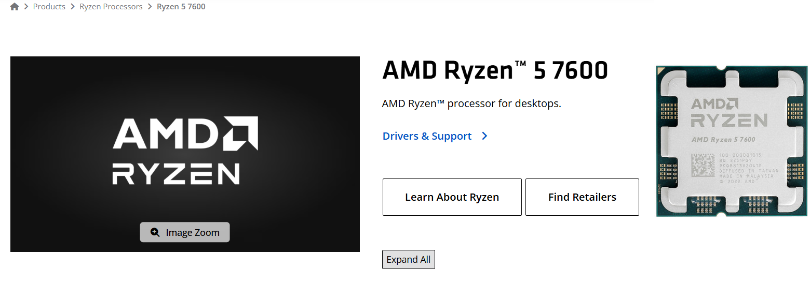  
Desktop CPU, Zen 4, 6 cores / 12 threads, 3.8 GHz base – 5.1 GHz boost, 65 W TDP, integrated Radeon Graphics.  
Connects to Socket AM5.  
Limits: AM5 only (physically incompatible with AM4), DDR5 memory only, official JEDEC speed DDR5-5200. The boxed version includes the Wraith Stealth cooler.  
Manufacturer page: https://www.amd.com/en/products/processors/desktops/ryzen/7000-series/amd-ryzen-5-7600.html

**Intel Core i5-13400**  
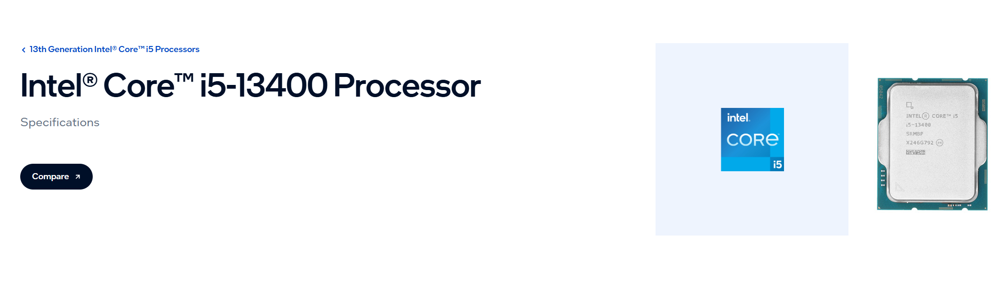  
Desktop CPU, 13th Generation (Raptor Lake), 10 cores (6P + 4E) / 16 threads, up to 4.6 GHz, 65 W base power, Intel UHD Graphics 730.  
Connects to Socket LGA1700.  
Limits: LGA1700 only. Supports both DDR4-3200 and DDR5-4800; the motherboard decides which type is used. The boxed version includes the Laminar RM1 cooler.  
Manufacturer page: https://ark.intel.com/content/www/us/en/ark/products/230495/intel-core-i513400-processor-20m-cache-up-to-4-60-ghz.html

### Motherboards

**ASUS PRIME B650M-A**  
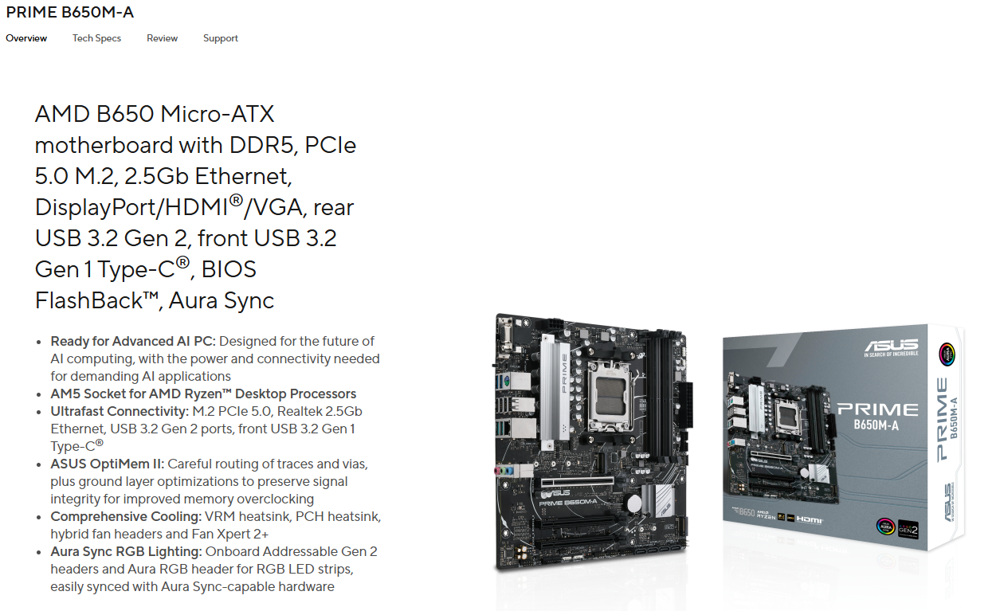  
Micro-ATX motherboard, Socket AM5, AMD B650 chipset, four DDR5 DIMM slots.  
Connects to: AM5 CPU, DDR5 modules, M.2 NVMe drives, SATA drives, 24-pin ATX + 8-pin EPS power.  
Limits: only Ryzen 7000/8000/9000 series CPUs, DDR5 memory only, no onboard Wi-Fi.  
Manufacturer page: https://www.asus.com/motherboards-components/motherboards/prime/prime-b650m-a/techspec/

**MSI PRO B760M-A WIFI DDR4**  
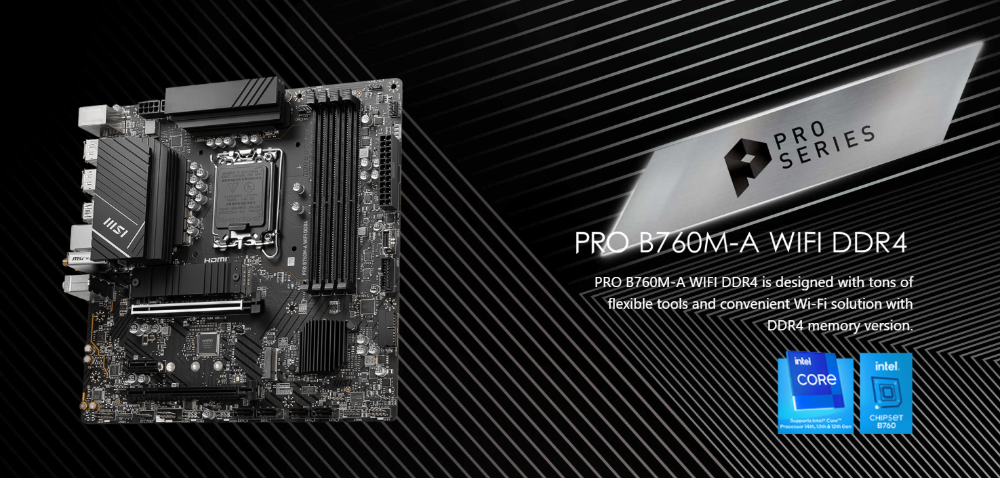  
Micro-ATX motherboard, Socket LGA1700, Intel B760 chipset, four DDR4 DIMM slots, Wi-Fi 6E and 2.5 GbE.  
Connects to: LGA1700 CPU, DDR4 modules, M.2 drives, SATA drives, 24-pin ATX + 8-pin EPS power.  
Limits: only Intel 12th/13th/14th Generation CPUs, DDR4 memory only.  
Manufacturer page: https://www.msi.com/Motherboard/PRO-B760M-A-WIFI-DDR4/Specification

### Memory

**Kingston FURY Beast DDR5-5600 16 GB**  
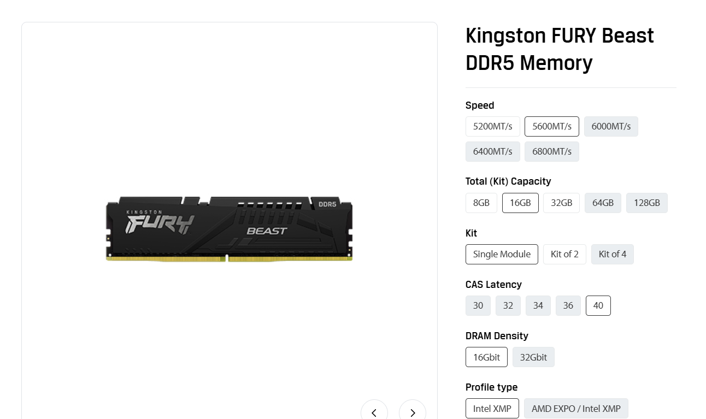  
DDR5 UDIMM, 16 GB, 5600 MT/s, 288 pins, non-ECC.  
Connects to one DDR5 DIMM slot.  
Limits: physically fits only DDR5 motherboards. The 5600 MT/s speed requires enabling an XMP or EXPO profile in the BIOS.  
Manufacturer page: https://www.kingston.com/en/memory/search?partid=KF556C40BB-16

**Crucial 16 GB DDR4-3200**  
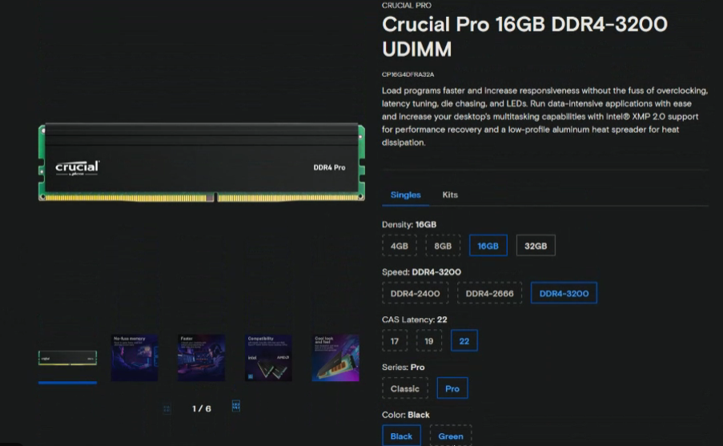  
DDR4 UDIMM, 16 GB, 3200 MT/s, 288 pins, non-ECC.  
Connects to one DDR4 DIMM slot.  
Limits: fits only DDR4 motherboards (the key notch is in a different position from DDR5, so the module cannot be inserted into a DDR5 slot).  
Manufacturer page: https://www.crucial.com/memory/ddr4/ct16g4dfra32a

### SSDs

**Samsung 990 PRO 1 TB**  
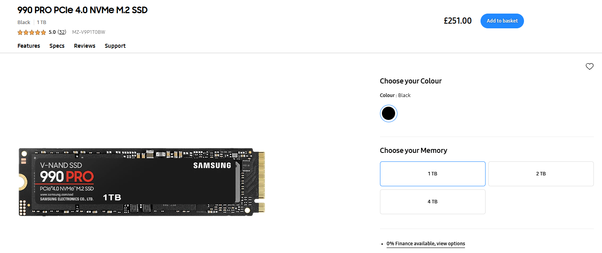  
NVMe SSD, M.2 2280 form factor, PCIe 4.0 x4, sequential read up to approximately 7450 MB/s.  
Connects directly into an M.2 slot (no data or power cables required).  
Limits: requires an M.2 slot that provides PCIe lanes; performance is reduced if the slot is only PCIe 3.0.  
Manufacturer page: https://semiconductor.samsung.com/consumer-storage/internal-ssd/990pro/

**Samsung 870 EVO 1 TB**  
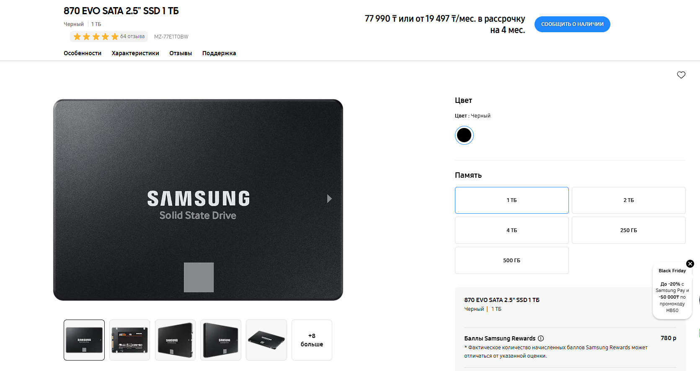  
2.5-inch SATA SSD, SATA 6 Gb/s interface, sequential read approximately 560 MB/s.  
Connects with a SATA data cable to the motherboard and a SATA power cable from the power supply.  
Limits: the SATA interface itself limits throughput to roughly 560 MB/s regardless of the drive’s internal capability.  
Manufacturer page: https://www.samsung.com/uk/memory-storage/sata-ssd/870-evo-1tb-sata-3-2-5-ssd-mz-77e1t0b-eu/

### Power and cooling

**Corsair RM750e 750 W**  
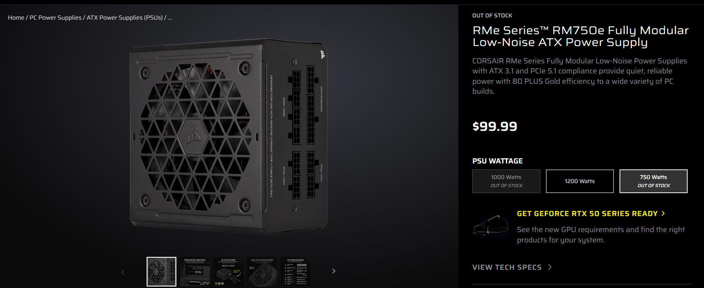  
Fully modular ATX power supply, 750 W continuous, 80 PLUS Gold.  
Connects: 24-pin to the motherboard, EPS 8-pin to the CPU, SATA and Molex to drives, PCIe to a graphics card.  
Limits: total continuous output is 750 W.  
Manufacturer page: https://www.corsair.com/us/en/p/psu/cp-9020262-na/rme-series-rm750e-fully-modular-low-noise-atx-power-supply-cp-9020262-na

**Stock coolers**

- **AMD Wraith Stealth** (included with Ryzen 5 7600)  
  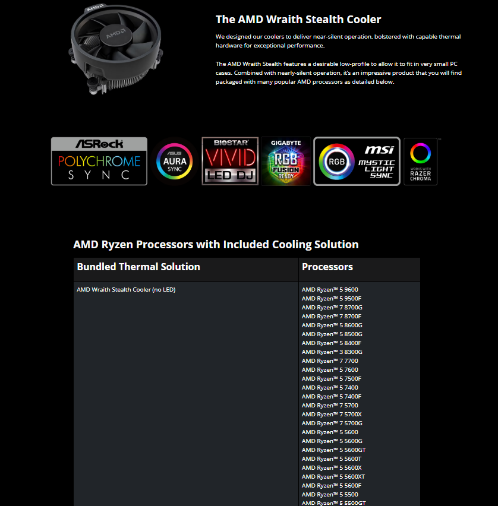  
  Low-profile cooler rated for 65 W CPUs. Mounts on the AM5 retention bracket and connects to the 4-pin CPU_FAN header.

- **Intel Laminar RM1** (included with boxed i5-13400)  
  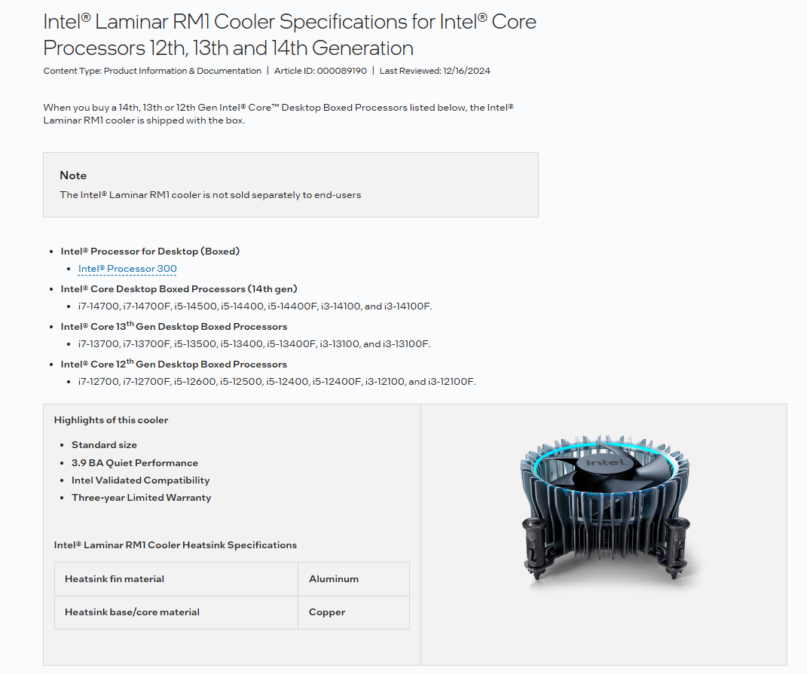  
  Stock cooler supplied with 12th/13th/14th Generation boxed processors. Mounts on the LGA1700 retention and connects to the 4-pin CPU_FAN header.

## 2. Motherboard comparison

| Feature              | ASUS PRIME B650M-A              | MSI PRO B760M-A WIFI DDR4          |
|----------------------|---------------------------------|------------------------------------|
| Socket               | AM5                             | LGA1700                            |
| Chipset              | AMD B650                        | Intel B760                         |
| Memory type          | 4 × DDR5                        | 4 × DDR4                           |
| Supported CPUs       | Ryzen 7000 / 8000 / 9000        | Intel 12th / 13th / 14th Gen       |
| Accepts Ryzen 5 7600 | Yes                             | No                                 |
| Accepts i5-13400     | No                              | Yes                                |
| Onboard Wi-Fi        | No                              | Yes (Wi-Fi 6E)                     |

## 3. Two builds that work

### Build A — AMD platform

| Component                     | Reason it belongs in this build |
|-------------------------------|---------------------------------|
| AMD Ryzen 5 7600              | Matches the only AM5 board. Integrated graphics remove the need for a discrete GPU. |
| ASUS PRIME B650M-A            | The only AM5 motherboard available. Provides HDMI/DisplayPort for the CPU graphics. |
| Kingston FURY Beast DDR5 16 GB| AM5 is DDR5-only; this is the only DDR5 module in the set. |
| Samsung 990 PRO 1 TB          | Installs in the M.2 slot and uses the full PCIe 4.0 link. |
| Corsair RM750e                | Supplies the required 24-pin and EPS 8-pin connectors with comfortable headroom. |
| Wraith Stealth                | Included in the Ryzen 5 7600 box. |

**Still required:** micro-ATX case, second DDR5 module for dual-channel operation, monitor, keyboard, mouse, operating system.

### Build B — Intel platform

| Component                     | Reason it belongs in this build |
|-------------------------------|---------------------------------|
| Intel Core i5-13400           | Matches the only LGA1700 board. Integrated UHD 730 graphics. Officially supports DDR4-3200. |
| MSI PRO B760M-A WIFI DDR4     | The only LGA1700 board. Provides DDR4 slots and built-in Wi-Fi. |
| Crucial DDR4-3200 16 GB       | The only DDR4 module available; runs at the CPU’s rated DDR4 speed. |
| Samsung 870 EVO 1 TB          | Uses the board’s SATA ports (the 990 PRO is already assigned to Build A). |
| Laminar RM1                   | Included with the boxed i5-13400. |

**Still required:** power supply (the single RM750e was allocated to Build A), micro-ATX case, SATA data cable, monitor, keyboard, mouse, operating system.

## 4. The same facts from the command line

| Fact                  | Windows (PowerShell)                                                                 | Linux                                      |
|-----------------------|--------------------------------------------------------------------------------------|--------------------------------------------|
| CPU model             | `Get-CimInstance Win32_Processor \| Select-Object Name`                             | `lscpu` (Model name)                       |
| Cores / threads       | `Get-CimInstance Win32_Processor \| Select-Object NumberOfCores, NumberOfLogicalProcessors` | `lscpu`                          |
| Total memory          | `(Get-CimInstance Win32_ComputerSystem).TotalPhysicalMemory`                        | `free -h`                                  |
| Memory modules        | `Get-CimInstance Win32_PhysicalMemory`                                              | `lsblk` / `free -h`                        |
| Disk model and type   | `Get-PhysicalDisk`                                                                  | `lsblk -d -o NAME,MODEL,SIZE,ROTA,TRAN`    |
| Free space            | `Get-Volume`                                                                        | `df -h`                                    |
| Firmware type         | `Get-CimInstance Win32_BIOS`                                                        | presence of `/sys/firmware/efi`            |

Raw command output is stored in:

- `evidence/windows-specs.txt`
- `evidence/linux-specs.txt`

The Linux data was collected inside the VirtualBox Ubuntu Server guest, therefore it describes the virtual machine rather than the physical laptop.

## What did not work the first time

- A retail listing incorrectly stated that the Ryzen 5 7600 uses Socket AM4. AMD’s own product page shows Socket AM5. Relying on the shop page would have produced an impossible combination of CPU and motherboard.
- The Crucial product page occasionally failed to load or redirected. The official datasheet and archived versions of the page were used instead.

## Evidence

- `evidence/photos/` — screenshots taken from the official manufacturer pages for every component (including both stock coolers)
- `evidence/windows-specs.txt` — complete PowerShell output from the host
- `evidence/linux-specs.txt` — complete command output from the Ubuntu Server VM
