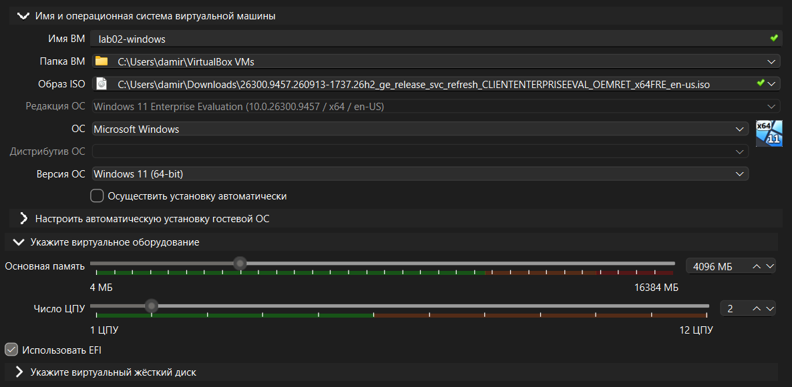
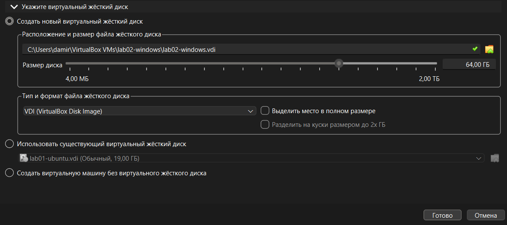
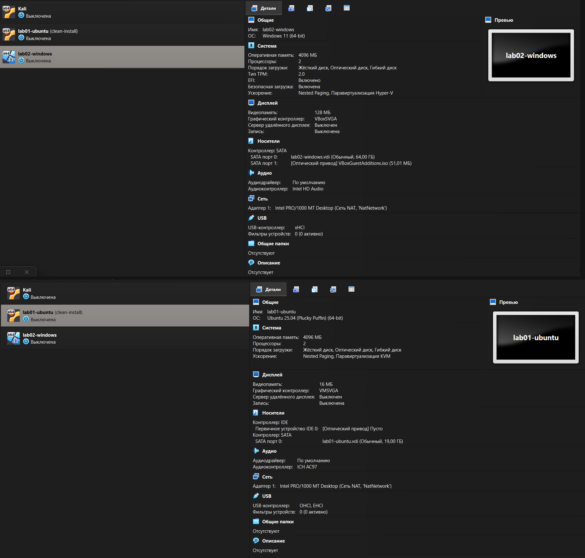

# How to build the test machines for a new developer

These instructions create two virtual machines:

* One **Ubuntu Server** (Linux)
* One **Windows 11**

They can talk to each other and both have internet access.  
A snapshot is included so the developer can break things and roll back.[cite: 4]

**Requirements:**
* About **40–50 GB** of free disk space
* Host laptop/PC with at least **8 GB RAM**

---

## Step 1. Install VirtualBox

1. Go to https://www.virtualbox.org/wiki/Downloads
2. Download the version for **Windows hosts**.
3. Install it with all default options.
4. Restart the computer if the installer asks you to.

> **Why VirtualBox?**  
> It is free, works on ordinary Windows laptops, and does not require a paid licence.  
> *(VMware Workstation Player was also considered, but VirtualBox is simpler for this use case.)*

---

## Step 2. Download the two operating system images

You need two ISO files:

1. **Ubuntu Server**  
   Download the latest LTS version from:  
   https://ubuntu.com/download/server

2. **Windows 11 Enterprise Evaluation**  
   Go to the Microsoft Evaluation Center, fill in the short form, and download the 64-bit ISO:  
   https://www.microsoft.com/en-us/evalcenter/download-windows-11-enterprise

Save both files in your **Downloads** folder. Do **not** put them inside any project folder.

---

## Step 3. Create the Ubuntu virtual machine

1. Open VirtualBox and click **New**.
2. Name: `lab01-ubuntu`
3. Type: **Linux** → **Ubuntu (64-bit)**
4. Memory: **4096 MB**
5. Processors: **2**
6. Hard disk: **Create a virtual hard disk now** → **25 GB**, **dynamically allocated**
7. Click **Finish**.

> **Why these numbers?**  
> The host has 16 GB of RAM and 12 threads. Giving the guest 4 GB RAM and 2 vCPU leaves enough resources for the second guest and for Windows itself.



---

## Step 4. Create the Windows virtual machine

1. Click **New** again.
2. Name: `lab02-windows`
3. Type: **Microsoft Windows** → **Windows 11 (64-bit)**
4. Tick **Skip Unattended Installation**
5. Memory: **4096 MB**
6. Processors: **2**
7. Hard disk: **64 GB**, **dynamically allocated** (do **not** tick *“Pre-allocate Full Size”*)
8. Click **Finish**.

After creation, open **Settings → System** and check that:
* **Enable EFI** is ticked
* **TPM** is set to **v2.0**
* **Secure Boot** is enabled

*These three options are required by Windows 11. Without them the installation will fail.*



---

## Step 5. Put both machines on the same network

1. In VirtualBox go to **File → Tools → Network Manager**.
2. Open the **NAT Networks** tab.
3. Create a new network (name it `NatNetwork` if it does not exist). Make sure **DHCP** is enabled.
4. For **each** virtual machine:
   * Open **Settings → Network**
   * Adapter 1 → Attached to: **NAT Network**
   * Name: **NatNetwork**

> **Why NAT Network and not ordinary NAT?**  
> Ordinary NAT gives each machine its own private network, so they cannot see each other. NAT Network puts them on the same internal network while still giving them internet access.



---

## Step 6. Install Ubuntu Server

1. Start `lab01-ubuntu`.
2. When asked, select the Ubuntu Server ISO.
3. Choose language → **English**.
4. On the “Keyboard configuration” screen, press **Enter**.
5. On the network screen, leave the defaults (DHCP) and continue.
6. On the “Guided storage configuration” screen, leave the defaults and continue.
7. Confirm the destructive action (this is a virtual disk, it is safe).
8. Set a username and password (remember them).
9. When asked about **SSH**, tick **Install OpenSSH server**.
10. Skip any additional snaps.
11. Wait for installation to finish, then select **Reboot Now**.
12. After reboot, log in with the credentials you created.

Verify the system:

```bash
uname -a
lsb_release -a
```

*(You should see Ubuntu and the kernel version.)*[cite: 1]

---

## Step 7. Install Windows 11

1. Start `lab02-windows`.[cite: 1]
2. Immediately press any key when you see *“Press any key to boot from CD or DVD…”*.[cite: 1]
3. Choose language and keyboard → **Next**.[cite: 1]
4. Click **I don't have a product key**.[cite: 1]
5. Select **Windows 11 Enterprise Evaluation**.[cite: 1]
6. Accept the licence terms.[cite: 1]
7. Choose **Custom: Install Windows only**.[cite: 1]
8. Select the virtual disk and click **Next**.[cite: 1]
9. Wait for installation and several reboots.[cite: 1]
10. When asked to sign in with a Microsoft account, choose **Domain join instead** (or *“Offline account”*).[cite: 1]
11. Create a local username and password.[cite: 1]
12. Skip privacy options as much as possible.[cite: 1]
13. After the desktop appears, install **Guest Additions**:[cite: 1]
    * In the VirtualBox menu: **Devices → Insert Guest Additions CD image**[cite: 1]
    * Run the installer inside Windows and reboot when finished.[cite: 1]

---

## Step 8. Check that everything works

### On Ubuntu[cite: 2, 3]

```bash
ip -br a
ping -c 4 10.0.2.4    # should reach Windows
ping -c 4 ubuntu.com  # should reach the internet
```
[cite: 2, 3]

### On Windows (PowerShell)[cite: 2, 3]

```powershell
ipconfig
ping 10.0.2.3         # should reach Ubuntu
ping ubuntu.com       # should reach the internet
```
[cite: 2, 3]

> **Firewall Troubleshooting:**  
> If the ping from Ubuntu to Windows fails, open **PowerShell as Administrator** on Windows and run:[cite: 2, 3]
> ```powershell
> New-NetFirewallRule -DisplayName "Allow ping in (ICMPv4)" -Protocol ICMPv4 -IcmpType 8 -Direction Inbound -Action Allow
> ```
> Then try the ping again.[cite: 2, 3]

---

## Step 9. Take a clean snapshot[cite: 4]

1. Completely shut down the Ubuntu machine (do not pause).[cite: 4]
2. In VirtualBox, select `lab01-ubuntu`.[cite: 4]
3. Click the **Snapshots** button (camera icon).[cite: 4]
4. Click **Take**.[cite: 4]
5. Name it exactly: `clean-install`[cite: 4]
6. Click **OK**.[cite: 4]

### How to roll back later[cite: 4]

If the developer breaks the Ubuntu machine:[cite: 4]

1. Shut down the virtual machine.[cite: 4]
2. Open the **Snapshots** view.[cite: 4]
3. Select `clean-install`.[cite: 4]
4. Click **Restore**.[cite: 4]
5. Confirm.[cite: 4]

*The machine will return to the exact state it was in when the snapshot was taken.*[cite: 4]

---

## Quick reference[cite: 4]

| Setting | Ubuntu | Windows 11 |
| :--- | :--- | :--- |
| **vCPU** | 2 | 2 |
| **RAM** | 4 GB | 4 GB |
| **Disk** | 25 GB dynamic | 64 GB dynamic |
| **Network** | NAT Network | NAT Network |
| **Firmware** | default | UEFI + Secure Boot + TPM 2.0 |
| **Snapshot** | `clean-install` | — |

[cite: 4]

*That is everything needed to rebuild the test environment from scratch.*[cite: 4]
